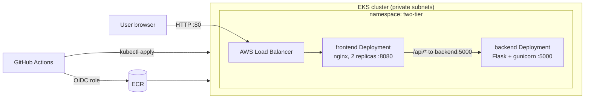

# Two-tier app on Amazon EKS

A small Python app (nginx frontend + Flask backend) deployed to EKS with Terraform and GitHub Actions.



**Tier 1, frontend:** nginx serves a static page and reverse-proxies `/api/*` to the backend. Exposed via a `LoadBalancer` Service.
**Tier 2, backend:** Flask REST API (`/api/health`, `/api/info`, `/api/tasks`). `ClusterIP` only, so it is not reachable from the internet.

## Repo layout

```
backend/            Flask API, tests, Dockerfile
frontend/           index.html, nginx.conf, Dockerfile
k8s/                namespace, backend, frontend manifests
terraform/          VPC, EKS, ECR, GitHub OIDC role
.github/workflows/  ci.yml (PRs/branches), deploy.yml (main -> EKS)
docker-compose.yml  run both tiers locally
```

## Prerequisites

AWS account and CLI (`aws configure`), Terraform >= 1.6, kubectl, Docker, and a GitHub account.

## Step 1: Run it locally

```bash
docker compose up --build
# open http://localhost:8080
```

Backend tests: `pip install -r backend/requirements-dev.txt && pytest -q backend/tests`

## Step 2: Push to GitHub

```bash
git init && git add . && git commit -m "Two-tier app on EKS"
git branch -M main
git remote add origin https://github.com/<you>/two-tier-eks.git
git push -u origin main
```

The deploy workflow will fail on this first push because AWS isn't set up yet. That's expected.

## Step 3: Create the infrastructure

```bash
cd terraform
cp terraform.tfvars.example terraform.tfvars   # set github_owner and github_repo
terraform init
terraform plan
terraform apply        # ~15 minutes
terraform output
```

If apply fails with "EntityAlreadyExists" on the OIDC provider, your account already has one: set `create_github_oidc_provider = false` and re-apply.

Connect kubectl:

```bash
$(terraform output -raw configure_kubectl)
kubectl get nodes
```

## Step 4: Wire GitHub to AWS

In the repo: Settings > Secrets and variables > Actions.

| Type | Name | Value |
|---|---|---|
| Secret | `AWS_ROLE_ARN` | `terraform output -raw github_actions_role_arn` |
| Variable | `AWS_REGION` | `terraform output -raw region` |
| Variable | `EKS_CLUSTER` | `terraform output -raw cluster_name` |
| Variable | `ECR_BACKEND` | `terraform output -raw ecr_backend_repo` |
| Variable | `ECR_FRONTEND` | `terraform output -raw ecr_frontend_repo` |

No AWS access keys are stored in GitHub. The workflow assumes the IAM role via OIDC, and the role only trusts pushes to `main` of your repo.

## Step 5: Deploy

Actions tab > "Build and deploy to EKS" > Run workflow (or push any change to `main`).

The pipeline runs tests, builds both images tagged with the short commit SHA, pushes them to ECR, deploys the backend and waits for it, deploys the frontend, then prints the app URL in the job summary.

```bash
kubectl get all -n two-tier
kubectl get svc frontend -n two-tier   # EXTERNAL-IP column is the app URL
```

## Step 6: Things to try

```bash
# Rolling update: change something in frontend/index.html, push, watch
kubectl get pods -n two-tier -w

# Self-healing
kubectl delete pod -n two-tier -l app=frontend

# Scale frontend
kubectl scale deploy/frontend -n two-tier --replicas=3

# Rollback
kubectl rollout history deploy/backend -n two-tier
kubectl rollout undo deploy/backend -n two-tier

# Logs
kubectl logs -n two-tier -l app=backend -f
```

Note: tasks are stored in backend memory, so they reset when the backend pod restarts. That's why the backend runs 1 replica. Adding Redis or RDS turns this into a 3-tier project.

## Step 7: Clean up (do this, EKS bills hourly)

Delete the Kubernetes LoadBalancer **before** `terraform destroy`. Otherwise the load balancer and its security group block VPC deletion.

```bash
kubectl delete namespace two-tier
# wait ~1 min for the load balancer to disappear
cd terraform && terraform destroy
```

Rough running cost: EKS control plane + NAT gateway + 2 x t3.medium + load balancer comes to a few dollars per day. Check current AWS pricing for your region.

## Troubleshooting

| Symptom | Likely cause |
|---|---|
| `Not authorized to perform sts:AssumeRoleWithWebIdentity` | `github_owner`/`github_repo` in tfvars don't match the repo exactly, or the run isn't on `main` |
| `kubectl` in workflow: `Unauthorized` | Access entry missing; re-run `terraform apply` |
| `EXTERNAL-IP` stuck on `<pending>` | Public subnets missing the `kubernetes.io/role/elb` tag (set by Terraform here) |
| Frontend pods crash: `host not found in upstream "backend"` | Backend Service not created yet; the workflow deploys backend first for this reason |
| Page loads but says backend unreachable | `kubectl get pods -n two-tier` and check backend logs |

## Next steps

- Add a Terraform plan/apply workflow with S3 remote state
- Replace the LoadBalancer Service with AWS Load Balancer Controller + Ingress (ALB, HTTPS via ACM)
- Package `k8s/` as a Helm chart or Kustomize overlays (dev/prod)
- Install metrics-server and add an HPA for the frontend
- Add Trivy image scanning to CI
- Move to GitOps with Argo CD
